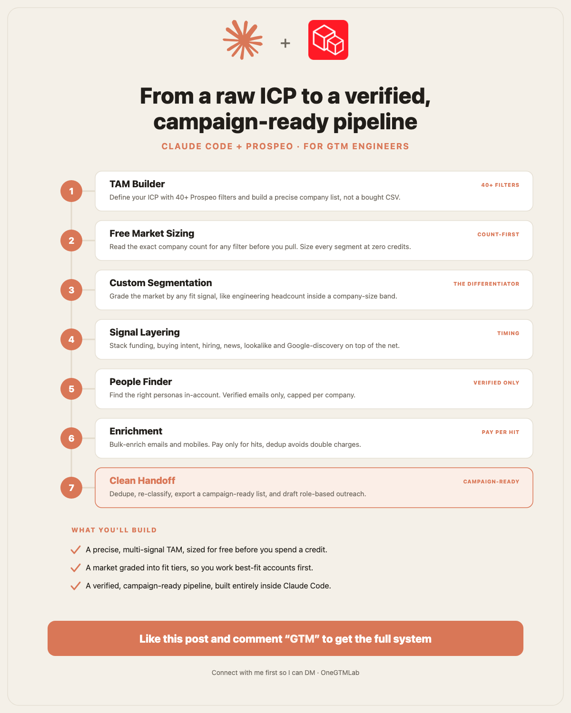

# claude-prospeo-gtm

**Go from an ICP to a verified, campaign-ready pipeline using only Claude Code + Prospeo.**



## What this is

A complete, reproducible GTM system for engineers. You describe an ICP; Claude Code drives the [Prospeo](https://prospeo.io) API to size the market for free, segment it on custom and buying signals, find verified people at the qualified accounts, enrich them to verified emails, and hand off a clean, deduped, campaign-ready list.

Everything runs inside **Claude Code** through the **Prospeo MCP server** plus your Prospeo API key. No dashboards, no spreadsheets, no second tool. The workflows in `workflows/` are prompts you run in Claude Code — each one is a stage of the pipeline, and `06-end-to-end-pipeline.md` chains them together.

Prospeo is a full company + people search database (40+ filters: firmographic, technographic, funding, intent, hiring, lookalike, ICP-of-the-company, Google-discovery, web-traffic) — not just an email finder. This repo is the operating manual for driving all of it from Claude.

## Quickstart

1. **Get a Prospeo API key.** Sign up at [prospeo.io](https://prospeo.io) and copy your API key from the account settings.
2. **Set your key.** Copy `.env.example` to `.env` and set `PROSPEO_API_KEY=your_key_here`.
3. **Wire up the MCP server.** The bundled `CLAUDE.md` wires the Prospeo MCP server into Claude Code so `search`, `enrich`, and `account` are available as tools the moment you open the project.
4. **Run a workflow.** Open Claude Code in this repo and run any file in `workflows/` (start with `01-icp-to-sized-tam.md`), or run `06-end-to-end-pipeline.md` for the full ICP → handoff pipeline.

> Auth detail: Prospeo uses the header `X-KEY: <api_key>` (not `Authorization: Bearer`). Host is `https://api.prospeo.io`. The MCP server handles this for you; you only need the key in `.env`.

## The pipeline

Seven stages, ICP in → campaign-ready list out:

1. **TAM Builder** — Turn an ICP into a multi-signal `/search-company` net (never `company_industry` alone — it undercounts). Resolve every location/industry/tech value verbatim via `/search-suggestions` first (free, 0 credits).
2. **Free Market Sizing** — Read `pagination.total_count` from page 1 to size the exact TAM *before* spending a credit. Pre-flight budget with `GET /account-information`.
3. **Custom Segmentation** — Split the TAM on firmographics, `company_attributes` (~45 booleans like `has_soc2`, `uses_ai`), `company_technology` (4,946 values), `company_revenue`, `company_funding`, and `company_keywords` — then re-classify each company from its returned `description_ai` / `description_seo`, not the industry tag.
4. **Signal Layering** — Add buying signals: `company_intent`, `company_news`, `company_job_posting_hiring_for`, `company_headcount_growth`, `company_key_execs`, `company_lookalike`, `company_icp`, `person_job_change`.
5. **People Finder** — Feed qualified domains back via the API-only `company.websites.include` (≤500/batch) with `person_job_title` boolean search, `person_seniority`, `person_contact_details` (VERIFIED), and `max_person_per_company` to spread contacts evenly.
6. **Enrichment** — `/bulk-enrich-person` up to 50 records/request, matching on `person_id`. Only spend credits on verified hits (`only_verified_email:true`); `NO_MATCH` is never charged. Mobiles are opt-in at 10 credits each.
7. **Clean Handoff** — Dedupe by root `domain`, confirm ICP fit from the description, and export a campaign-ready CSV.

## Workflows

Each file is a runnable Claude Code prompt. Run one, or chain them with the end-to-end file.

- [`workflows/01-icp-to-sized-tam.md`](workflows/01-icp-to-sized-tam.md) — ICP → resolved values → multi-signal net → free `total_count` sizing.
- [`workflows/02-segment-by-custom-signal.md`](workflows/02-segment-by-custom-signal.md) — Slice a TAM by firmographic, technographic, funding, and keyword signals.
- [`workflows/03-layer-buying-signals.md`](workflows/03-layer-buying-signals.md) — Add intent, news, hiring, headcount-growth, and exec-change triggers.
- [`workflows/04-find-verified-people.md`](workflows/04-find-verified-people.md) — Qualified domains → persona `/search-person` with verified-contact filtering.
- [`workflows/05-enrich-and-export.md`](workflows/05-enrich-and-export.md) — Bulk-enrich to verified emails, dedupe, export campaign-ready.
- [`workflows/06-end-to-end-pipeline.md`](workflows/06-end-to-end-pipeline.md) — The full ICP → sized TAM → segment → signal → people → enrich → handoff run.

## Prompts

Reusable prompt snippets — scoping questions, filter recipes, and count-first patterns — live in [`PROMPTS.md`](PROMPTS.md). Paste them into Claude Code when you want a single step rather than a full workflow.

## Repo layout

```
claude-prospeo-gtm/
├── README.md
├── CLAUDE.md              # wires the Prospeo MCP server into Claude Code
├── PROMPTS.md             # reusable prompt snippets
├── .env.example           # PROSPEO_API_KEY=your_key_here
├── infographic.png
└── workflows/
    ├── 01-icp-to-sized-tam.md
    ├── 02-segment-by-custom-signal.md
    ├── 03-layer-buying-signals.md
    ├── 04-find-verified-people.md
    ├── 05-enrich-and-export.md
    └── 06-end-to-end-pipeline.md
```

## Credits & safety

Size before you spend:

- **Count-first is free.** `pagination.total_count` (page 1) and `GET /account-information` cost 0 credits. `/search-suggestions` is free too — always resolve values there first.
- **Search is 1 credit per 25.** One credit buys a page of up to 25 companies or people. A 2,000-company TAM ≈ 80 credits.
- **Enrich pays per verified hit.** 1 credit per verified email found; `NO_MATCH` is never charged. Mobiles are 10 credits each and opt-in.
- **Re-runs are free inside the dedup windows.** Identical searches repeat free for 30 days; re-enriching the same record is free for 90 days.

Example targets are generic (e.g. "a security vendor", "a fintech"). Bring your own ICP.

## License

MIT — see [`LICENSE`](LICENSE).

---

Built by [OneGTMLab](https://www.onegtmlab.dev), a GTM engineering agency. More free GTM systems and tool reviews: [onegtmlab.dev/tool-directory](https://www.onegtmlab.dev/tool-directory).
